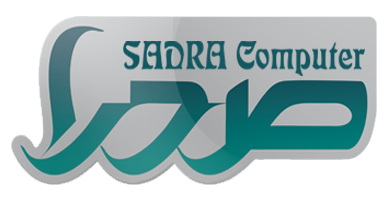

# 🤖 دستیار هوشمند صدرا | Sadra AI

یک رابط وب مدرن و تعاملی مبتنی بر هوش مصنوعی (الهام‌گرفته از رابط کاربری Google Gemini) برای شرکت دانش‌بنیان **صدرا رایانه نوین طبرستان** (برندهای ایران‌کامپایل، صدرا کامپیوتر و صدراتک).



---

## ✨ ویژگی‌های کلیدی

- 💎 **رابط کاربری لوکس و مینیمال (Dark Mode):** طراحی اختصاصی به سبک Gemini با پالت رنگی هماهنگ، فونت زیبای وزیرمتن و افکت‌های مدرن شیشه‌ای (Glassmorphism).
- ⚡ **استریم زنده پاسخ‌ها (Streaming SSE):** دریافت بلادرنگ توکن‌ها با افکت روان ماشین تحریر (Typewriter Animation) و نشانگر کرسر نئونی.
- 🧠 **تفکیک و نمایش استدلال هوش مصنوعی (Reasoning Box):** آکاردئون اختصاصی برای مشاهده فرآیند فکر کردن و استدلال مدل قبل از پاسخ نهایی.
- 💻 **هایلایت هوشمند کدها و پیش‌نمایش زنده (Live Preview):**
  - شناسایی خودکار کدهای HTML/CSS/JS
  - امکان تست و اجرای آنی کد در محیط ایزوله دسکتاپ، تبلت و موبایل
  - کپی سریع کد با یک کلیک
- 🏢 **دانش عمیق شرکتی (Company Knowledge Base):**
  - شناخت کامل تاریخچه، مجوزها و تاییدیه‌های دانش‌بنیان صدرا کامپیوتر
  - اطلاعات جامع خدمات توسعه نرم‌افزار، طراحی وب و پلتفرم‌های ابری
  - مشخصات کامل و راه‌های ارتباطی شعب بابل، تهران و قایمشهر
  - پاسخ‌گویی مستقیم و حرفه‌ای بدون اطناب کلام
- 📱 **کاملاً واکنش‌گرا (Responsive):** بهینه‌سازی دقیق برای اجرا در تمامی دستگاه‌ها از جمله موبایل، تبلت و دسکتاپ.

---

## 🛠 فناوری‌های استفاده‌شده

- **Frontend:** Vanilla HTML5, CSS3, JavaScript (ES6+)
- **Font & Icons:** فونت Vazirmatn، آیکون‌های Font Awesome 6.5
- **Markdown & Code Highlighting:** Marked.js, Highlight.js (github-dark theme)
- **AI Model & API:** پشتیبانی از مدل `apodex/apodex-1.1-mini:free` از طریق OpenRouter API

---

## 🚀 نحوه اجرا

این پروژه کاملاً ایستا (Static Front-end) است و بدون نیاز به نصب هیچ‌گونه وابستگی یا پیش‌نیاز سروری اجرا می‌شود:

1. مخزن را کلون کنید:
   ```bash
   git clone https://github.com/alihamidi85/sadra-ai.git
   ```
2. پوشه پروژه را باز کنید:
   ```bash
   cd sadra-ai
   ```
3. فایل `index.html` را در مرورگر وب دلخواه خود باز کنید یا با یک Live Server محلی اجرا نمایید.

---

## 🏢 درباره شرکت صدرا رایانه نوین طبرستان

شرکت «صدرا رایانه نوین طبرستان» (شماره ثبت ۸۵۵۰) از سال ۱۳۹۷ با نشان ملی ثبت رسانه‌های دیجیتال و تأییدیه رسمی معاونت علمی و فناوری ریاست جمهوری به عنوان شرکت دانش‌بنیان، ارائه‌دهنده راهکارهای نوین نرم‌افزاری، آموزش برنامه‌نویسی و خدمات تخصصی فناوری اطلاعات در سطح کشور فعالیت می‌کند.

- 🌐 وب‌سایت: [irancompile.com](https://www.irancompile.com)
- 📞 تلفن پشتیبانی: ۰۱۱۳۲۳۶۶۲۷۲ | ۰۱۱۳۲۳۶۶۲۷۳
- 📍 دفتر مرکزی: مازندران، بابل، خیابان مدرس، جنب بانک ملی، ساختمان صدرا
