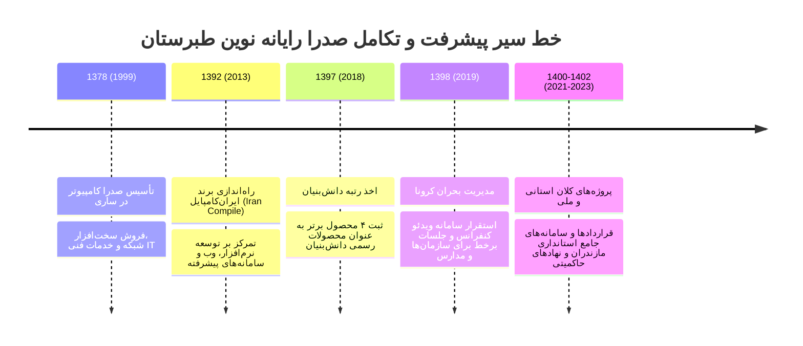

# مستندات جامع دانش و شناسنامه شرکت دانش‌بنیان مهندسی صدرا رایانه نوین طبرستان
> **برندها و نشان‌های تجاری:** صدرا کامپیوتر (Sadra Computer - تأسیس ۱۳۷۸) | ایران‌کامپایل (Iran Compile - تاسیس ۱۳۹۲) | صدراتک و صدراسافت (sadrasoft.ir)  
> **وب‌سایت رسمی:** [www.irancompile.com](https://www.irancompile.com) | [sadrasoft.ir](https://sadrasoft.ir)

---

## ۱. هویت رسمی، مجوزها و اعتبارات قانونی
- **نام ثبتی و حقوقی:** شرکت مهندسی صدرا رایانه نوین طبرستان (سهامی خاص)
- **وضعیت دانش‌بنیان:** دارای تأییدیه و گواهینامه رسمی شرکت دانش‌بنیان از معاونت علمی، فناوری و اقتصاد دانش‌بنیان ریاست جمهوری (از سال ۱۳۹۷ با تأیید و ثبت ۴ محصول فناورانه شاخص).
- **عضویت‌های صنفی و حاکمیتی:** 
  - عضو رسمی سازمان نظام صنفی رایانه‌ای کشور (نصر) و نظام صنفی رایانه‌ای مازندران.
  - دارای تأییدیه‌ها و رضایت‌نامه‌های کتبی حسن انجام کار از نهادهای دولتی و استانی (از جمله استانداری مازندران، کانون مهندسین، و مجامع خیریه).
- **دفتر مرکزی و موقعیت:** استان مازندران، شهرستان ساری.
- **تلفن و نمابر:** `011-33312405` و `011-33312406` (پیش‌شماره ۰۱۱ مازندران)
- **ایمیل‌های رسمی:** `info@irancompile.com` و `sadrasoft@mail.ir`
- **حوزه‌های تخصصی فعالیت:**
  1. تحلیل، طراحی، معماری و تولید نرم‌افزارهای تخصصی و سامانه‌های سازمانی کلان.
  2. پیاده‌سازی پورتال‌های یکپارچه خدمات الکترونیک اداری و حاکمیتی.
  3. طراحی اپلیکیشن‌های بومی و چندسکویی موبایل (Android و iOS).
  4. سامانه‌های هوشمند مبتنی بر هوش مصنوعی، داشبوردهای BI و گزارش‌گیری تحلیلی.
  5. میزبانی ابری با پایداری ۹۹.۹٪، هاستینگ سازمانی و خدمات امنیت شبکه در برابر حملات DDoS.

---

## ۲. تاریخچه و خط زمانی پیشرفت (از ۱۳۷۸ تا کنون)

1. **فروردین ۱۳۷۸ (۱۹۹۹) - تأسیس و آغاز راه (صدرا کامپیوتر):**  
   شروع فعالیت در استان مازندران، شهرستان ساری با نام **صدرا کامپیوتر**. ارائه خدمات پایه رایانه‌ای، تجهیزات شبکه، فروش و ارتقای سخت‌افزار و زیرساخت‌های فناوری اطلاعات.
2. **خرداد ۱۳۹۲ (۲۰۱۳) - جهش فناوری و برند ایران‌کامپایل:**  
   تأسیس دپارتمان تخصصی برنامه‌نویسی و مهندسی نرم‌افزار با نام تجاری **ایران‌کامپایل (Iran Compile)**. جهت‌گیری به سوی تولید سامانه‌های تحت وب مقیاس‌پذیر، پورتال‌های الکترونیکی و نرم‌افزارهای سفارشی برای بخش خصوصی و ادارات دولتی.
3. **بهمن ۱۳۹۷ (۲۰۱۸) - دریافت گواهینامه رسمی دانش‌بنیان:**  
   پس از ارزیابی‌های فنی موشکافانه معاونت علمی و فناوری ریاست جمهوری، شرکت با ثبت ۴ محصول فناورانه بومی به عنوان **شرکت دانش‌بنیان مهندسی صدرا رایانه نوین طبرستان** تأیید صلاحیت شد.
4. **سال ۱۳۹۸ (۲۰۱۹) - همه‌گیری کرونا و بومی‌سازی جلسات آنلاین:**  
   با ورود کشور به شرایط بحرانی کووید-۱۹، تیم مهندسی شرکت سامانه بومی ویدئو کنفرانس و ارتباطات برخط را عملیاتی کرد که نقشی حیاتی در تداوم ارتباطات استانداری، فرمانداری‌ها، شهرداری‌ها و مراکز آموزشی استان ایفا نمود.
5. **مهر ۱۴۰۰ تا ۱۴۰۲ (۲۰۲۱-۲۰۲۳) - تثبیت جایگاه به عنوان بازوی نرم‌افزاری استانداری مازندران:**  
   طراحی، توسعه و بهره‌برداری موفق از مجموعه‌ای جامع از نرم‌افزارهای مدیریتی، نظارتی و مالی در سطح استان مازندران با دریافت لوح‌ها و رضایت‌نامه‌های کتبی.

---

## ۳. خدمات جامع ۷ گانه شرکت

| ردیف | عنوان خدمت | شرح و ویژگی‌های فنی |
|:---:|:---|:---|
| ۱ | **پورتال‌های سازمانی و شرکتی** | طراحی پرتال‌های یکپارچه خدمات الکترونیک، اتوماسیون گردش کار، میز خدمت هوشمند و سامانه‌های درون‌سازمانی با معماری میکروسرویس و ماژولار. |
| ۲ | **تولید نرم‌افزارهای اختصاصی سفارشی** | تحلیل فرآیندی کسب‌وکار، مهندسی نیازمندی‌ها و کدنویسی نرم‌افزارهای سازمانی خاص بر پایه فریمورک‌های مدرن با مقیاس‌پذیری بالا. |
| ۳ | **طراحی وب‌سایت‌های پیشرفته و سئو** | ساخت وب‌سایت‌های شرکتی، خدماتی و فروشگاهی با طراحی اختصاصی UI/UX مدرن، سرعت لود بهینه‌شده، واکنش‌گرایی کامل و سئوی تکنیکال. |
| ۴ | **توسعه اپلیکیشن‌های موبایل (Android / iOS)** | پیاده‌سازی اپ‌های سازمانی و عمومی موبایل، هماهنگ با سامانه‌های ابری، ارتباط امن با وب‌سرویس‌ها و کاربری آسان. |
| ۵ | **توسعه و شخصی‌سازی وردپرس** | توسعه اختصاصی قالب و پلاگین‌های پیشرفته وردپرس با رعایت بالاترین استانداردهای امنیتی و سرعت لود بالا با هزینه اقتصادی. |
| ۶ | **امنیت سایبری و حفاظت در برابر DDoS** | حفاظت از وب‌سرویس‌ها و سرورها در برابر حملات لایه ۳، ۴ و ۷ (DDoS Protection)، فایروال‌های WAF اختصاصی و مانیتورینگ امنیتی ۲۴ ساعته. |
| ۷ | **میزبانی و هاستینگ ابری سازمانی** | سرورهای ابری پایدار، پهنای باند اختصاصی، پشتیبان‌گیری منظم روزانه و هفتگی، و پشتیبانی فنی ۲۴ ساعته در ۷ روز هفته. |

---

## ۴. کاتالوگ تفصیلی محصولات و نرم‌افزارها (پرتفوی رسمی ایران‌کامپایل)

### الف) دسته مالی، اداری و نظارتی (Financial & Administrative)

#### ۱. نرم‌افزار مدیریت بودجه، یکپارچه‌سازی و نظارت (مباه)
- **شناسه:** Product ID 6
- **شرح فنی:** وب‌اپلیکیشن جامع مدیریت مالی و انبارداری سازمانی با قابلیت برنامه‌ریزی و کنترل بودجه، نظارت دقیق بر هزینه‌ها، گزارش‌گیری تحلیلی، مدیریت موجودی کالا و ثبت مکانیزه ورود و خروج انبار.
- **ویژگی‌های برجسته:** بهره‌گیری از هوش مصنوعی برای پیش‌بینی انحراف بودجه، کنترل اعتبارات فصول و ردیف‌های مالی، هشدارهای خودکار کسری موجودی، و گزارش‌های آماری پویا.
- **کارفرمای شاخص:** استانداری مازندران (معاونت توسعه مدیریت و منابع).

#### ۲. سامانه رفاهی سازمانی
- **شناسه:** Product ID 3
- **شرح فنی:** سامانه یکپارچه رفاهی برای سازمان‌ها و شرکت‌های بزرگ جهت دسترسی عادلانه، شفاف و آسان پرسنل و خانواده‌های آن‌ها به امکانات رفاهی، اقامتی، ورزشی، بیمه‌ای و بسته‌های تسهیلاتی.
- **امکانات:** رزرو نوبت‌بندی مجتمع‌های رفاهی، تخصیص سهمیه‌ها بر اساس امتیاز پرسنلی، صدور فیش الکترونیک، و نظرسنجی کیفیت خدمات.

#### ۳. نرم‌افزار مدیریت جلسات
- **شناسه:** Product ID 7
- **شرح فنی:** سامانه جامع مکانیزه‌سازی فرآیند جلسات اداری از درخواست و تعیین تقویم تا برگزاری و ثبت صورت‌جلسات.
- **امکانات:** رزرو سالن جلسات و تجهیزات، دعوت هوشمند مدعوین با پیامک و ایمیل، بارگذاری دستور جلسه و مستندات، امضای دیجیتال صورت‌جلسه، و ثبت وظایف مصوب برای اعضا.

#### ۴. نرم‌افزار پژوهش سازمانی
- **شناسه:** Product ID 8
- **شرح فنی:** سامانه جامع مدیریت امور پژوهشی، اتصال جامعه دانشگاهی و نخبگان به ساختارهای تصمیم‌گیری اداری و استانداری.
- **امکانات:** فراخوان اولویت‌های پژوهشی، ثبت و دریافت پروپوزال‌ها، داوری الکترونیک بدون نام، قراردادهای پژوهشی، رصد پیشرفت فازها و پرداخت‌های مالی طرح‌ها.

#### ۵. نرم‌افزار مدیریت مصوبات
- **شناسه:** Product ID 9
- **شرح فنی:** سامانه پایش و کنترل لحظه‌ای چرخه حیات مصوبات جلسات شوراها، کارگروه‌ها و هیئت‌مدیره‌ها.
- **امکانات:** تقطیع صورت‌جلسات به بندهای مصوبه، ارجاع هوشمند به دستگاه‌ها یا افراد مجری، تعیین ضرب‌الاجل (مهلت اقدام)، گزارش درصد پیشرفت و ارسال اخطار تأخیر.

#### ۶. نرم‌افزار پیگیری دستورات
- **شناسه:** Product ID 11
- **شرح فنی:** ابزار پایش و ارزیابی فرآیندی میزان تحقق دستورات کتبی و شفاهی مدیران ارشد سازمان.
- **امکانات:** رهگیری سرنوشت دستورات از زمان صدور تا اجرا، کاهش شدید نامه‌نگاری‌های زائد، شفافیت در پاسخگویی پرسنل و شاخص‌سازی سرعت عمل مدیران میانی.

#### ۷. نرم‌افزار آموزش از راه دور (LMS)
- **شناسه:** Product ID 10
- **شرح فنی:** سامانه یادگیری الکترونیکی و برگزاری دوره‌های آموزش ضمن خدمت کارکنان و دوره‌های تخصصی آزاد.
- **امکانات:** بارگذاری محتوای مالتی‌مدیا و درسنامه‌ها، برگزاری آزمون‌های تستی و تشریحی آنلاین با سیستم تصحیح خودکار، صدور خودکار گواهینامه معتبر پایان دوره، و وبینار تعاملی.

---

### ب) دسته نرم‌افزارهای میدانی و کاربردی (Operational & Field Software)

#### ۸. سامانه نقلیه سازمانی (رانیکان - Ranikan)
- **شناسه:** Product ID 1
- **شرح فنی:** سامانه هوشمند پایش لحظه‌ای و مدیریت ناوگان حمل‌ونقل سازمانی در بستر اپلیکیشن موبایل رانندگان و پنل تحت وب مدیران.
- **امکانات:** ثبت هوشمند مأموریت‌ها و درخواست خودرو توسط کارمندان، مسیریابی و ردیابی لحظه‌ای با GPS، ثبت مصرف سوخت و کارکرد کیلومتر، مدیریت تعمیرات، سرویس‌های دوره‌ای و بیمه، و کارتابل گزارش‌گیری هزینه‌ها.
- **کارفرمای نمونه:** استانداری مازندران.

#### ۹. نرم‌افزار ویدئو کنفرانس برخط (Online Conference)
- **شناسه:** Product ID 2
- **شرح فنی:** سامانه بومی و امن ارتباطات چندرسانه‌ای صوتی و تصویری برای برگزاری جلسات از راه دور، کلاس‌های مجازی و وبینارها با پهنای باند سازگار با اینترنت داخلی.
- **امکانات:** عدم وابستگی به سرورهای خارجی، رمزنگاری End-to-End، اشتراک‌گذاری دسکتاپ و اسناد، تخته‌سیاه تعاملی، ضبط ابری جلسات، و امکان حضور بدون نیاز به نصب نرم‌افزار (تحت وب WebRTC).

#### ۱۰. اپلیکیشن مدیریت مراکز آموزشی بامداد (Bamdad LMS/SIS)
- **شناسه:** Product ID 4
- **شرح فنی:** وب‌اپلیکیشن و سامانه مدیریت هوشمند مدارس، دبیرستان‌ها، آموزشگاه‌ها و مؤسسات علمی.
- **امکانات:** حضور و غیاب هوشمند با اطلاع‌رسانی پیامکی آنی به اولیاء، ثبت مستمر نمرات و صدور الکترونیکی کارنامه تحصیلی، کتابخانه دیجیتال، سامانه تکالیف و آزمون آنلاین، چت معلم و اولیا.

#### ۱۱. سامانه جامع انتخابات صدرا (Sadra Election)
- **شناسه:** Product ID 5
- **شرح فنی:** سامانه مکانیزه برگزاری انتخابات الکترونیکی برای مجامع عمومی شرکت‌ها، اتاق‌های بازرگانی، احزاب، کانون‌های مهندسین و انجمن‌های صنفی.
- **امکانات:** تعریف نامزدها، ائتلاف‌ها و حوزه‌های انتخابیه، کنترل دقیق هویت رأی‌دهندگان با کد ملی و پیامک رمز یکبار مصرف (OTP)، پروتکل ضد جعل و عدم امکان ثبت رأی تکراری، تجمیع آنی و انتشار شفاف نتایج پس از پایان زمان رأی‌گیری.

#### ۱۲. نرم‌افزار نئو (Neo Framework)
- **شناسه:** Product ID 12
- **شرح فنی:** نسل نوین پلتفرم ماژولار و بستر زیرساختی نرم‌افزارهای یکپارچه سازمانی و اداری با امکان افزودن ماژول‌های دلخواه بر اساس جریان کار شرکت.

#### ۱۳. نرم‌افزار سرو (Sarv Monitoring)
- **شناسه:** Product ID 13
- **شرح فنی:** سامانه جامع رصد و ارزیابی عملکرد واحدهای تابعه، ادارات شهرستان‌ها و معاونت‌های استانداری بر مبنای شاخص‌های عمومی و اختصاصی سالانه.

---

### ج) پروژه‌های شاخص استانی و حاکمیتی صدرا رایانه در مازندران
۱. **نرم‌افزار مدیریت ناجیان غریق استان مازندران (ناجی):**  
   سامانه استانی مدیریت پایگاه‌های ساحلی، حضور و غیاب ناجیان غریق، پایش حوادث دریایی، پرداخت حق‌الزحمه و نظارت بر طرح سالمسازی ۳۳۸ کیلومتر از نوار ساحلی دریای خزر در مازندران.
۲. **نرم‌افزار مدیریت ترافیک استانی (سمتا):**  
   سامانه تجمیع داده‌های ترددشمارها، دوربین‌های نظارتی، وضعیت محورهای مواصلاتی کوهستانی (هراز، کندوان، فیروزکوه) و مدیریت ناوگان حمل‌ونقل عمومی استان.
۳. **نرم‌افزار نظارت جامع استانی بر تغییر کاربری‌ها (نجات):**  
   سامانه پایش هوشمند، گزارش‌های مردمی و گشت‌های ویژه جهت مقابله با ساخت‌وسازهای غیرمجاز و حفظ اراضی زراعی و باغات شمال کشور.
۴. **پورتال یکپارچه کانون مهندسین شهرستان بابل:**  
   طراحی پورتال اعضا، مدیریت ارجاع نظارت، درگاه پرداخت اینترنتی حق عضویت و آزمون‌های نظام مهندسی.
۵. **پورتال مجمع خیرین میراث میرما:**  
   سامانه ثبت کمک‌های مردمی، مدیریت پرونده‌های مددجویی و شفافیت مالی امور خیریه.

---

## ۵. مشتریان، کارفرمایان و رضایت‌نامه‌های حسن انجام کار

شرکت دانش‌بنیان صدرا رایانه نوین طبرستان دارای گنجینه‌ای ارزشمند از رضایت‌نامه‌ها و تاییدیه‌های رسمی از معتبرترین سازمان‌های کشور است:

| سازمان / کارفرما | مقام تأییدکننده | موضوع پروژه و تأییدیه |
|:---|:---|:---|
| **استانداری مازندران** | سیده معصومه سجادیان امیری (مدیر فناوری اطلاعات و شبکه دولت) | حسن انجام کار در طراحی، پشتیبانی و توسعه سامانه‌های حمل‌ونقل، مالی، نظارتی و پرتال استانداری |
| **کانون مهندسین شهرستان بابل** | مهندس ادهم قلی‌پور (رئیس کانون) | رضایت‌نامه رسمی بابت طراحی پورتال جامع کانون مهندسین و راه‌اندازی درگاه‌های پرداخت برخط |
| **مجمع خیرین میراث میرما** | آقای مطلبی (مدیرعامل مجمع) | رضایت‌نامه بابت توسعه نرم‌افزار و مدیریت کمک‌های خیریه |
| **آموزش و پرورش مازندران** | اداره کل استان | استقرار سامانه‌های آموزشی و بامداد در مدارس |
| **شرکت گاز استان مازندران** | فناوری اطلاعات | پورتال‌های درون‌سازمانی و اطلاع‌رسانی |
| **اداره کل استاندارد مازندران** | مدیریت IT | سامانه‌های گردش کار و اداری |
| **اداره کل ICT استان مازندران** | اداره کل ارتباطات | همکاری در طرح‌های استانی فناوری اطلاعات |
| **شهرداری و فرمانداری قائم‌شهر** | روابط عمومی و IT | وب‌سایت‌ها و پورتال‌های خدمات الکترونیک شهری |
| **سازمان نظام مهندسی ساختمان مازندران** | مدیریت انفورماتیک | همکاری در راهکارهای مهندسی و نظارتی |

---

## ۶. فرآیند ۳ مرحله‌ای خرید و همکاری سازمانی
۱. **قدم اول - ثبت‌نام:** ایجاد حساب کاربری شرکتی یا شخصی در وب‌سایت رسمی `irancompile.com`.
۲. **قدم دوم - دریافت مشاوره فنی رایگان و بررسی دمو:**  
   - بررسی دقیق نیازمندی‌های اختصاصی سازمان با حضور مهندسان نرم‌افزار.
   - ارائه نسخه دموی تعاملی محصولات مورد نظر.
   - تدوین RFP و تنظیم قرارداد اختصاصی سازمانی با شرایط پرداخت منعطف و اقساطی برای سازمان‌ها.
۳. **قدم سوم - استقرار، آموزش و پشتیبانی ۲۴/۷:**  
   - نصب روی سرورهای اختصاصی سازمان (On-Premise) یا میزبانی ابری امن.
   - برگزاری کارگاه‌های آموزشی تخصصی برای مدیران و کارشناسان.
   - ارائه گارانتی و پشتیبانی بی‌وقفه در تمام ساعات شبانه‌روز.

---

## ۷. اطلاعات تماس و شبکه‌های اجتماعی
- **نشانی مرکزی:** ایران، استان مازندران، شهرستان ساری
- **تلفن‌های واحد فروش و پشتیبانی:** `011-33312405` و `011-33312406`
- **پست الکترونیکی:**
  - پست الکترونیکی اصلی: `info@irancompile.com`
  - پست الکترونیکی پشتیبانی: `sadrasoft@mail.ir`
- **وب‌سایت‌ها:**
  - وب‌سایت مرجع ایران‌کامپایل: [https://www.irancompile.com](https://www.irancompile.com)
  - پرتال نرم‌افزاری صدراسافت: [https://sadrasoft.ir](https://sadrasoft.ir)
- **شبکه‌های اجتماعی:**
  - اینستاگرام: [@sadrasoft1378](https://www.instagram.com/sadrasoft1378)
  - لینکدین: [Sadra Rayane Novin Tabarestan](https://www.linkedin.com/company/sadra-rayane-novin-tabarestan/)
  - پیام‌رسان بله و ویراستی: حساب رسمی صدرا رایانه نوین طبرستان
